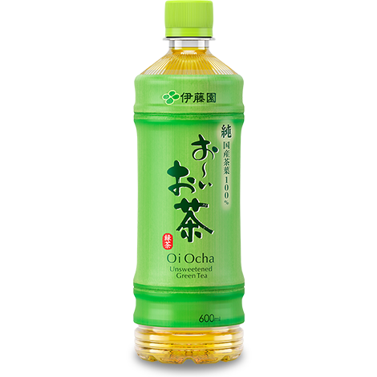
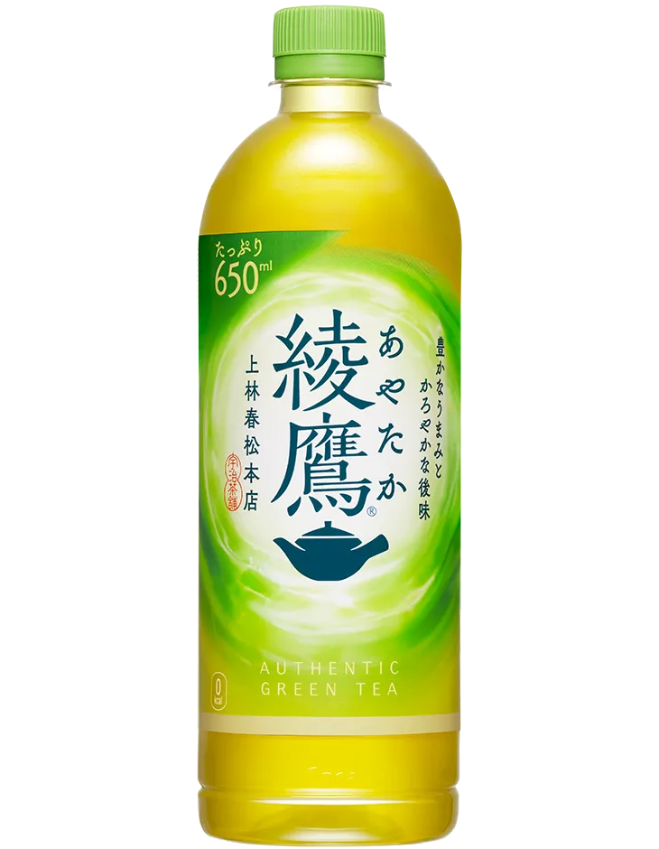
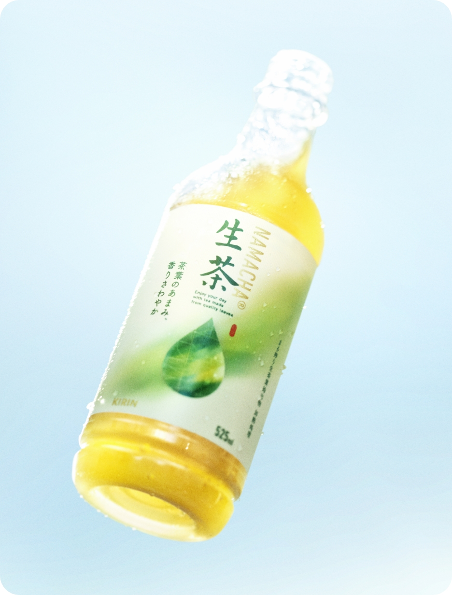

# 私が思うおいしい緑茶ランキング

緑茶が好きなわたしが、綾鷹・お〜いお茶・伊右衛門・生茶の4種類を比較し、独自の視点でランキング形式に紹介します。

色んな観点から緑茶のの違い独断と偏見で分析します！

---

🍃 観点

それぞれのお茶を、以下の5つのポイントから評価します。

25点満点で表します！

* 味：お茶本来の味わい（5点）
* 香り：飲むときに感じる香り（5点）
* 苦味：苦味の強さやバランス（5点）
* 後味：飲んだ後に残る味わい（5点）
* 飲みやすさ：日常的に飲みやすいか（5点）

---

# 4位

## お〜いお茶

### 14点

* 味：5点
* 香り：3点
* 苦味：1点
* 後味：2点
* 飲みやすさ：3点

#### 私の評価
飲んだときの味はすっきりしているが、苦味が強く、後味にも苦い味が残る...。
渋めが好きな人はいいかも。

# 3位🥉

## 綾鷹

### 19点

* 味：4点
* 香り：4点
* 苦味：3点
* 後味：3点
* 飲みやすさ：5点

#### 私の評価
飲みやすさ抜群！日本茶らしい味わい。ただ後味に若干の苦味が残る印象。

# 2位🥈

## 生茶

### 20点

* 味：5点
* 香り：5点
* 苦味：4点
* 後味：4点
* 飲みやすさ：2点

#### 私の評価
味はすごくおいしい！し好き！口当たりがとても爽やか。茶葉が残りがちなのが惜しい...。

# 1位🥇

## 伊右衛門

### 21点

* 味：4点
* 香り：5点
* 苦味：4点
* 後味：4点
* 飲みやすさ：4点

#### 私の評価
味も香りもすっきりしているのにどこか奥深いバランス型。定期的に飲みたくなる緑茶。
